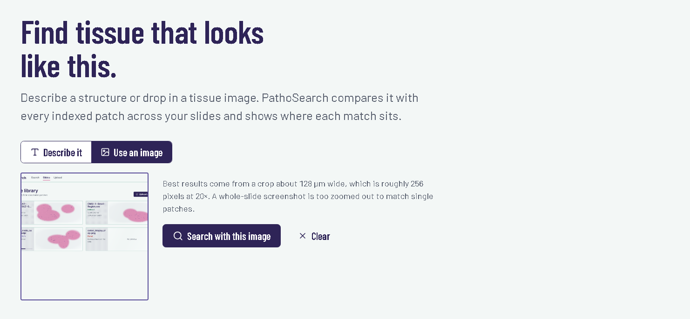
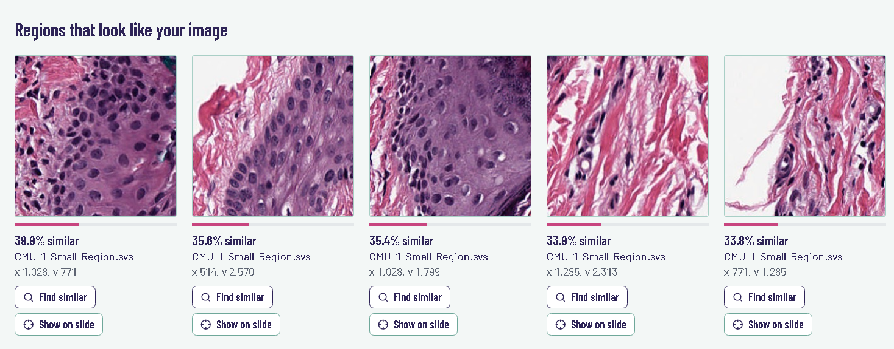
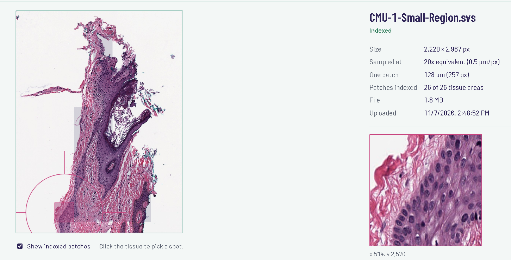
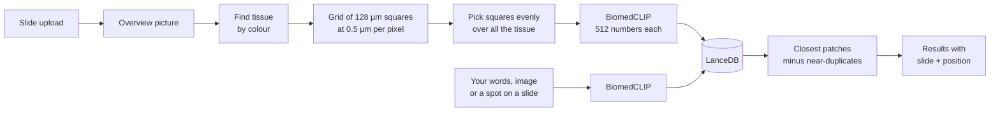

# PathoSearch 🔬

**A search engine for microscope slides. Search by describing what you're looking for, by
dropping in a picture, or by clicking a spot on a slide, and see exactly where each match is.**

**Live demo:** https://stupendous-fairy-8e4426.netlify.app/

> The first visit after a quiet period can take 30–60 seconds. The server switches itself off
> when nobody is using it (to save money) and needs a moment to start again.

> **PathoSearch is a research and teaching tool. It is not a medical device and must not be used
> for diagnosis.**

---

## What it does

When doctors study a disease in tissue, a very thin slice of it is coloured with special stains
and put on a glass slide. Hospitals and labs now **scan** these slides into huge digital images.
A lab can collect thousands of them.

The problem: **you can't search inside them.** A slide usually comes with only a file name.
Nothing records *what is where* on the slide. To answer a question like *"where else in our
collection is there tissue that looks like this?"* someone has to open slide after slide and
look by eye.

PathoSearch makes a slide collection searchable, a bit like searching a photo library:

- **Describe it:** type *"lymphocytes"* or *"adipose tissue"* and get the matching regions.
- **Show it:** drop in a picture of some tissue and find regions that look like it.
- **Point at it:** click any spot on a slide and find similar tissue on all your other slides.

Every result shows which slide it came from and its exact position, and opens the slide with
that spot marked.

| Search by description | Slide library | Slide viewer |
|---|---|---|
|  |  |  |

---

## Why this is hard

- **The images are enormous.** One scanned slide is often 50,000 × 50,000 pixels or more, and can
  be several gigabytes. No AI model can look at that in one go, so it has to be cut into small
  squares first. One slide can give tens of thousands of squares.
- **Most of the image isn't tissue.** There's empty glass, dust, pen marks and black unscanned
  areas. If you don't remove them, you waste time and get junk results.
- **Slides are scanned at different zoom levels.** Some at 20×, some at 40×, on different
  machines. The same cell would look twice as big on one as on the other unless you correct for it.
- **There are no labels.** Nobody has written a description for each region, so normal keyword
  search has nothing to search.
- **A result has to be checkable.** It's only useful if you can see which slide it's from and
  exactly where, and look at it yourself.

---

## How it works, step by step

### When you upload a slide

1. **The file is saved** to disk piece by piece (8 MB at a time), so even a huge file doesn't fill
   the computer's memory. A fingerprint of the file (SHA-256) is taken; if you upload the **same
   file twice**, it isn't indexed again.
2. **The upload finishes immediately.** The slow work happens in the background, one slide at a
   time, with a progress bar. If the server stops halfway, the job starts again when the server
   comes back.
3. **A small overview picture** of the whole slide is made (at most 2,048 pixels on its longest side).
4. **Tissue is found on that overview.** Stained tissue is colourful (pink and purple); glass is
   white or grey and unscanned areas are black, and neither is colourful. So the app marks every
   pixel that is **colourful enough and not too dark** as tissue. How colourful counts as
   "enough" is worked out automatically for each slide (a method called Otsu's threshold). Tiny
   specks are cleaned away.
5. **A grid is laid over the slide.** Each grid square covers **128 × 128 micrometres** of real
   tissue, whatever scanner made the slide. Squares that are at least half tissue are kept.
6. **If there are more squares than the limit** (2,000 by default), they are picked **evenly across
   the whole slide**, not just from the top.
7. **Each square is read from the slide** at the right zoom, turned into a **256 × 256 picture**,
   and checked again at full detail to make sure it really is tissue. These squares are called
   **patches**.
8. **Each patch becomes a list of 512 numbers.** An AI model called **BiomedCLIP** (by Microsoft)
   looks at the patch and describes it as 512 numbers, called an **embedding**. Similar-looking
   tissue gets similar numbers.
9. **The numbers are stored in LanceDB**, a database built for finding similar lists of numbers.
   The patch positions and slide details are stored in a small **SQLite** database.
10. The slide is marked **done**, or **failed** with a reason (for example *"No tissue found on this slide."*).

### When you search

1. Your search (words, a picture, or a spot on a slide) goes through the **same BiomedCLIP model**
   and becomes 512 numbers too.
2. LanceDB finds the stored patches whose numbers are **closest** to your search.
3. It fetches **10 times more** candidates than it will show. Then, if several results are
   neighbouring squares of the **same spot** (within 2 patches of each other on one slide), only
   the best one is kept. That way you see 12 different places, not 12 copies of one place.
4. Each result shows the patch, the slide's name, its position, and a score.

### Key ideas in plain words

| Term | What it means |
|---|---|
| **Whole-slide image (WSI)** | A scan of an entire glass slide. It is stored as a stack of the same picture at several zoom levels (like a map you can zoom), for example a `.svs` file. |
| **Patch** | A small square cut from a slide. Here: 256 × 256 pixels showing 128 µm of tissue. |
| **µm (micrometre)** | One thousandth of a millimetre. A typical cell is about 10 µm across. |
| **µm per pixel** | How much real tissue one pixel shows. 0.5 µm per pixel is about 20× magnification; 0.25 is about 40×. PathoSearch samples every slide at **0.5 µm per pixel** so all slides are compared at the same zoom. |
| **Level-0** | The full-detail layer of a slide. Every x/y position in PathoSearch is in level-0 pixels. |
| **H&E stain** | The most common pair of stains: they colour cell nuclei purple and the rest pink. |
| **Embedding** | A list of numbers describing what a picture (or a sentence) looks like. Think of it as an address on a map of appearances: similar things live close together. |
| **BiomedCLIP** | An AI model trained on millions of biomedical pictures and their captions, so it understands both tissue images and medical words. This repo uses `microsoft/BiomedCLIP-PubMedBERT_256-vit_base_patch16_224`. |
| **Cosine similarity** | A number that measures how close two embeddings are. Closer to 1 means more alike. |
| **Vector database (LanceDB)** | A database that is good at answering "which stored items are most similar to this one?" |

---

## The three ways to search

| How | What you do | What the app does |
|---|---|---|
| **Describe it** | Type a description, or click an example (*lymphocytes*, *adipose tissue*, *necrosis*, *gland*…). | Turns your words into numbers. It actually uses three phrasings of your words (your text as typed, *"this is a photo of …"*, and *"an H&E stained histopathology image of …"*) and averages them, which makes results steadier. |
| **Use an image** | Drop, choose or paste a PNG or JPEG (under 50 MB). Best: a crop about 256 pixels wide at 20×. | Turns your picture into numbers and finds patches that look like it. |
| **Click a spot** | Open a slide, click anywhere on the tissue, press **Find similar tissue**. | Reads that spot from the slide, turns it into numbers and finds similar patches on all slides, **leaving out the spot you clicked**. |

From any result you can press **Find similar** to search again from that patch, or
**Show on slide** to open its slide with the spot marked.

### How to read the scores

- **Image and spot search** show **"% similar"**: the cosine similarity × 100.
- **Text search** shows **"Score 0.xx"**, and the bar is drawn relative to the best result.
  Matching words with pictures gives naturally lower numbers than picture-to-picture, so a text
  score is only useful for **comparing results of the same search**, not as a percentage.

---

## What you see in the app

| Page | What it does |
|---|---|
| **Search** | Search by description or by image. Shows results as a grid of patches. |
| **Slides** | Your slide library: overview pictures, status (*Waiting to index*, *Indexing* with %, *Indexed*, *Failed* with the reason), number of patches. Refreshes by itself only while something is being indexed. |
| **Slide viewer** | The slide's overview picture. Click a spot to select it and press **Find similar tissue**. The **coverage** overlay (on by default) shows exactly which squares were indexed. Lists the slide's size, the zoom it was sampled at, how much tissue one patch covers, patches indexed, file size and upload date. **Re-index** and **Delete** buttons (on a public site, only for people with the admin key). |
| **Upload** | Drop in a slide and choose how detailed the index should be: **Quick** (500 patches), **Standard** (2,000), **Detailed** (5,000) or **Everything** (up to 20,000). More patches means better coverage but longer indexing. |

The status at the top right shows *Loading BiomedCLIP* while the AI model starts, then
**Ready on CUDA / MPS / CPU** (CUDA is an NVIDIA graphics card, MPS is an Apple chip's graphics,
CPU is the main processor).
It shows *Backend offline* if the server can't be reached, and *Model failed to load* (hover for
the reason) if something went wrong.

---

## Who can do what

- **On your own computer**, there's no login: you can do everything.
- **On a public deployment**, set an **admin key** (see [Put it online](#put-it-online-modal--netlify)).
  Then:
  - **Anyone** can search, browse the slide library and view slides.
  - **Only someone with the admin key** can upload, re-index or delete. You type the key once
    on the Upload page; it's saved in your browser.

There are no user accounts or private slides: everyone who can open the site sees every slide.

---

## Tech stack

| Part | Technology |
|---|---|
| Reading slides | OpenSlide (`openslide-python` + `openslide-bin`), Pillow |
| AI model | BiomedCLIP, loaded with `open_clip_torch`, running on PyTorch (NVIDIA GPU, Apple chip, or CPU) |
| Similarity search | LanceDB (cosine distance) |
| Slide records, jobs, patch positions | SQLite |
| Server (backend) | Python, FastAPI, Uvicorn |
| Website (frontend) | React 19, Vite 7, plain CSS, lucide-react icons |
| Hosting (optional) | Modal (backend on a T4 GPU) + Netlify (website) |

---

## How the parts connect



---

## Project structure

```text
PathoSearch/
├── backend/
│   ├── main.py            # The web server: all routes (upload, search, slides, patches)
│   ├── config.py          # All settings in one place (zoom, patch limits, search)
│   ├── slide_io.py        # Opens slides and images; reads patches; reads µm per pixel
│   ├── tissue.py          # Finds tissue, lays out the grid, picks squares evenly
│   ├── extractor.py       # Plans which patches to take from a slide
│   ├── model.py           # Loads BiomedCLIP in the background; turns images and text into numbers
│   ├── vector_store.py    # LanceDB: add, delete and search patch numbers
│   ├── database.py        # SQLite: slides, job status, patch positions
│   ├── worker.py          # Background indexing queue with progress, resumes after a restart
│   ├── ranking.py         # Removes near-duplicate results
│   ├── storage.py         # Saves the databases to durable storage (used on Modal)
│   ├── requirements.txt
│   ├── tests/             # test_logic.py, test_worker.py, test_storage.py
│   └── data/              # made when the server runs: slides, overviews, databases
├── frontend/
│   ├── src/
│   │   ├── pages/         # SearchPage, SlidesPage, SlideViewer, UploadPage
│   │   ├── components/    # ResultGrid, SlideCard
│   │   ├── api.js         # Talks to the backend
│   │   ├── router.js      # Page addresses like #/search, #/slides
│   │   └── styles.css
│   ├── package.json
│   └── vite.config.js     # Sends /api requests to the backend during development
├── deploy/
│   └── modal_app.py       # Runs the backend on Modal (GPU + storage)
├── FIXES.md               # What was wrong in version 1 and how it was fixed
└── README.md
```

---

## API endpoints

All positions (`x`, `y`) are **level-0 pixels** of the original slide. Interactive docs are at
`/docs` on the backend (for example `http://127.0.0.1:8000/docs`).

| Method | Route | What it does |
|---|---|---|
| GET | `/api/health` | Is the model ready, which device, is OpenSlide installed, is an admin key required, how many slides and patches |
| POST | `/api/slides` | Upload a slide (`file`, optional `max_patches` from 50 to 20,000). Indexing runs in the background |
| GET | `/api/slides` | List all slides with status and progress |
| GET | `/api/slides/{id}` | One slide's details |
| DELETE | `/api/slides/{id}` | Delete a slide, its file and its patches (not allowed while it is being indexed) |
| POST | `/api/slides/{id}/reindex` | Index a slide again (optional `max_patches`) |
| GET | `/api/slides/{id}/thumbnail` | The overview picture |
| GET | `/api/slides/{id}/patches` | Positions of all indexed patches (for the coverage overlay) |
| GET | `/api/slides/{id}/patch?x=&y=` | A 256 × 256 picture of the slide at x, y |
| GET | `/api/search/text?q=` | Search by description (2–300 characters) |
| POST | `/api/search/image` | Search with a picture (`file`, PNG or JPEG under 50 MB) |
| GET | `/api/search/similar?slide_id=&x=&y=` | Find patches like the one at x, y (leaves that spot out) |
| POST | `/upload_slide/`, `/search_patch/` | The original version-1 routes, still working |

Searches return 12 results by default (`top_k`, up to 100). When an admin key is set, uploading,
re-indexing and deleting need the header `X-Admin-Token: <key>`.

---

## Run it on your computer

You need **Python 3.10 or newer** (3.11 recommended) and **Node.js 20.19 or newer**. A graphics
card is optional: on the CPU, indexing is slower but works.

### 1. Start the backend

**Windows (PowerShell)**
```powershell
cd backend
python -m venv venv
venv\Scripts\Activate.ps1
python -m pip install -r requirements.txt
python -m uvicorn main:app --port 8000
```

**macOS / Linux**
```bash
cd backend
python3 -m venv venv
source venv/bin/activate
pip install -r requirements.txt
python -m uvicorn main:app --port 8000
```

The server starts right away and loads the AI model in the background. The **first start
downloads BiomedCLIP (about 800 MB)**. The API is at `http://127.0.0.1:8000`.

**NVIDIA graphics card on Windows:** the normal `pip install torch` only uses the CPU. To use the
graphics card, install PyTorch with the command for your system from
[pytorch.org](https://pytorch.org/get-started/locally/).

### 2. Start the website (in a second terminal)

```bash
cd frontend
npm install
npm run dev
```

Open **http://localhost:5173**. Wait until the top right says *Ready on …*.

**One server instead of two:** run `npm run build` in `frontend`, restart the backend, and open
`http://127.0.0.1:8000`. The backend then serves the website itself.

### 3. Try it

1. Download OpenSlide's free sample slide
   [CMU-1-Small-Region.svs](https://openslide.cs.cmu.edu/download/openslide-testdata/Aperio/CMU-1-Small-Region.svs)
   (about 1.9 MB, 20×). For a full-size slide, try `CMU-1.svs` from the same
   [folder](https://openslide.cs.cmu.edu/download/openslide-testdata/Aperio/).
2. Go to **Upload**, drop the file in and click **Upload and index**.
3. When the slide shows as **Indexed**, go to **Search** and try *adipose tissue* or *lymphocytes*. Or
   open the slide, click a spot and press **Find similar tissue**.

---

## Put it online (Modal + Netlify)

The backend runs on [Modal](https://modal.com) with a T4 graphics card, and the website is a
static site on [Netlify](https://netlify.com). Anyone can search; uploading, re-indexing and
deleting need an **admin key** that only you know.

You need a Modal account **with a payment method** (Modal requires one for graphics cards), and the
Modal command-line tool logged in: `python -m pip install modal`, then `python -m modal setup`.

### 1. Cap your spending
On modal.com, open **Usage & Billing** and set a **Workspace budget** (for example the free
monthly credit), so a public site can never cost more than you expect.

### 2. Create the admin key (once)
```bash
python -c "import secrets; print(secrets.token_urlsafe(24))"
python -m modal secret create pathosearch-secrets PATHOSEARCH_ADMIN_TOKEN=<the key printed above>
```
Keep the key somewhere safe. To change it later, run the same command with `--force`.

### 3. Deploy the backend
From the `PathoSearch` folder:
```bash
python -m modal deploy deploy/modal_app.py
```
The first deploy takes 10–15 minutes, because it builds the server and downloads BiomedCLIP into it
(so later starts don't have to). At the end, copy the URL after `web =>`. It looks like
`https://<your-modal-username>--pathosearch-web.modal.run`.

Check it: open `https://<your-url>/api/health`. After 30–60 seconds (the server starting up) you
should see `"model_ready": true`.

### 4. Build the website with that URL

**Windows (PowerShell)**
```powershell
Set-Content -Path frontend\.env -Value "VITE_API_URL=https://<your-url>.modal.run" -Encoding ascii
cd frontend
npm install
npm run build
```

**macOS / Linux**
```bash
echo "VITE_API_URL=https://<your-url>.modal.run" > frontend/.env
cd frontend
npm install
npm run build
```

This creates `frontend/dist` with your backend address built in.

### 5. Put it on Netlify
1. Log in at [netlify.com](https://netlify.com).
2. Open [app.netlify.com/drop](https://app.netlify.com/drop) and drag the **`frontend/dist`** folder onto it.
3. You get a `*.netlify.app` link. Rename it under **Site configuration → Change site name**.

PathoSearch's page addresses start with `#/`, so Netlify needs no extra redirect rules.

### 6. Add slides
Open your site, go to **Upload**, paste your admin key, and upload slides. Visitors without the
key can search and view slides but can't change anything.

### Updating
- Backend: `python -m modal deploy deploy/modal_app.py` (slides, patches and records are kept).
- Website: `npm run build`, then drag the new `dist` folder onto your site's **Deploys** page.

### How it runs on Modal (and what it costs)
- **One server** runs everything: the API, the indexing queue and the AI model. It shuts down
  after **10 idle minutes**, so you only pay while people use it. You can change `IDLE_SHUTDOWN_S`,
  or set `GPU = None` (CPU only: cheaper, but indexing is much slower), in `deploy/modal_app.py`.
- **Slide files** are kept on Modal's permanent storage (a "Volume" called `pathosearch-data`).
  The **databases** run on the server's own fast disk and are copied to the Volume after every
  upload, finished job, re-index request and delete, then copied back when the server starts again.
- **The website only checks on the server when it needs to** (while the model is loading, while a
  slide is being indexed, or when you come back to the tab), so an open tab doesn't keep the
  paid graphics card running.
- **Uploads are limited to 2 GB on Modal** (10 GB on your own computer). Change
  `PATHOSEARCH_MAX_UPLOAD_GB` in `deploy/modal_app.py` if you need bigger files.
- If the server stops in the middle of indexing, that job **starts again automatically** the next
  time the site is opened.

---

## Settings

Settings live in `backend/config.py`. The ones marked *(env)* can also be set as environment variables.

| Setting | Default | What it means |
|---|---|---|
| `TARGET_MPP` | `0.5` | µm per pixel every slide is sampled at (0.5 = 20×) |
| `PATCH_SIZE` | `256` | Patch size in pixels (256 px × 0.5 µm = 128 µm) |
| `DEFAULT_MAX_PATCHES` | `2000` | Most patches per slide (if there's more tissue, they're picked evenly) |
| `MIN_TISSUE_FRACTION` | `0.5` | How much of a grid square must be tissue to be kept |
| `MIN_SATURATION` | `20` | The least colourful a pixel can be and still count as stained tissue |
| `DARK_VALUE` | `40` | Pixels darker than this are treated as dirt or marks, not tissue |
| `DEFAULT_TOP_K` | `12` | Results per search |
| `NEIGHBOUR_DISTANCE` | `2.0` | Results closer than this many patches on one slide count as the same spot |
| `PATHOSEARCH_DATA` (env) | `backend/data` | Where slides and overview pictures are stored |
| `PATHOSEARCH_DB_DIR` (env) | same as data | Where SQLite and LanceDB are stored |
| `PATHOSEARCH_ADMIN_TOKEN` (env) | empty | If set, uploading, re-indexing and deleting need this key |
| `PATHOSEARCH_MAX_UPLOAD_GB` (env) | `10` | Largest upload accepted |
| `PATHOSEARCH_CORS` (env) | localhost:5173 | Websites allowed to call the API (`*` = any) |

If you change how patches are made (zoom, size, tissue rules), press **Re-index** on your slides
so their stored patches match.

---

## Tests

The tests need only **numpy** and **Pillow** (no AI model, OpenSlide or LanceDB). They use small
made-up slides. Run them from the `backend` folder:

```bash
python tests/test_logic.py    # tissue finding, whole-slide coverage, zoom, duplicate removal (13 checks)
python tests/test_worker.py   # a full indexing job with a stand-in model (10 checks)
python tests/test_storage.py  # saving and restoring the databases, used on Modal (5 checks)
```

Each prints `ALL PASSED` when everything works.

---

## Troubleshooting

| Problem | Fix |
|---|---|
| Upload says OpenSlide isn't installed | `pip install openslide-python openslide-bin` (this includes the OpenSlide library, also on Windows) |
| Status says *Backend offline* | Start the backend: `python -m uvicorn main:app --port 8000` in `backend` |
| Status says *Model failed to load* | Hover it for the reason. Usually a package mismatch: `pip install -U open_clip_torch "transformers>=4.40,<5"` |
| Indexing is slow | It's running on the CPU. Choose **Quick** (500 patches), or install PyTorch with GPU support |
| A slide failed with *No tissue found* | The stain is very faint. Lower `MIN_SATURATION` in `config.py` and press **Re-index** |
| `.mrxs` / `.vms` files are rejected | These formats are made of several files. Convert to a single-file format first |
| Port 8000 is already in use | Use another port, and change the address in `frontend/vite.config.js` to match |
| Live site: "Admin key required" | Enter the key from step 2 of the deploy guide on the Upload page |
| Live site: "Backend offline" for a minute | The server is starting. Wait 30–60 seconds |
| Live site: upload rejected as too large | Files over 2 GB are refused on Modal. See *How it runs on Modal* |
| Modal deploy: secret `pathosearch-secrets` not found | Do step 2 of the deploy guide first |
| Modal deploy: "add a payment method to use T4" | Add a card on Modal, or set `GPU = None` in `deploy/modal_app.py` |

---

## Privacy

Real patient slides can contain information that identifies a person. PathoSearch never reads the
slide's label or its small "macro" photo, only the tissue image itself. Even so, **don't put
identifiable patient data on a public server.** For demos, use public collections such as the
OpenSlide test data, TCGA or CAMELYON.

---

## Known limitations

In plain words, here is what PathoSearch doesn't do yet:

- **No user accounts.** There is one admin key for uploading and deleting. Everyone who can open
  the site sees every slide.
- **One slide is indexed at a time.** Other uploads wait in a queue. On Modal, everything runs on
  one server with one graphics card, so searches can be a bit slower while a slide is indexing.
- **No colour correction between labs.** The same tissue can be stained lighter or darker in
  different labs or scanners, which can make matches between them weaker.
- **Ordinary pictures (PNG/JPEG) have no zoom information.** For them, patches are simply 256 pixels
  of whatever zoom the picture was taken at, so they're not on the same scale as real slides.
- **Text search depends on what BiomedCLIP learned.** Common descriptions work best; very specific
  or rare terms may give weak results. Text scores are only for comparing results of one search.
- **The viewer shows a still overview picture**, not a zoomable slide.
- **Search compares your query with every stored patch.** That's fast for thousands to hundreds of
  thousands of patches; millions would need a faster index.
- **Multi-file slide formats** (`.mrxs`, `.vms`) aren't supported.
- **On Modal, uploads are capped at 2 GB**, and some real slides are bigger.

---

## Roadmap

- [ ] Login and a separate slide library per user
- [ ] Colour (stain) normalisation for slides from different labs
- [ ] A faster index for millions of patches
- [ ] A zoomable viewer instead of a still overview

See [FIXES.md](FIXES.md) for everything that was changed from version 1, and why.
