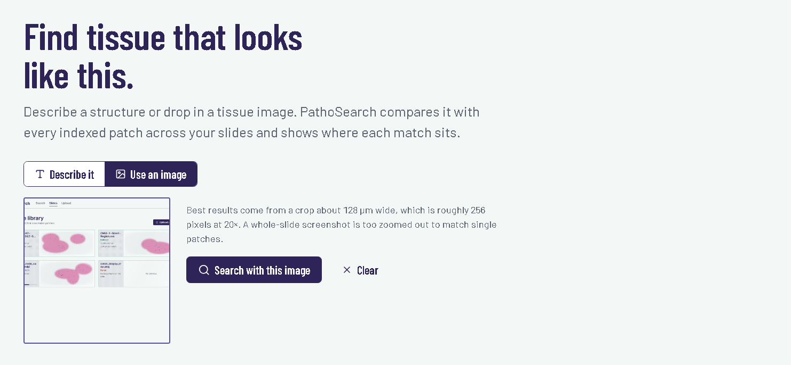
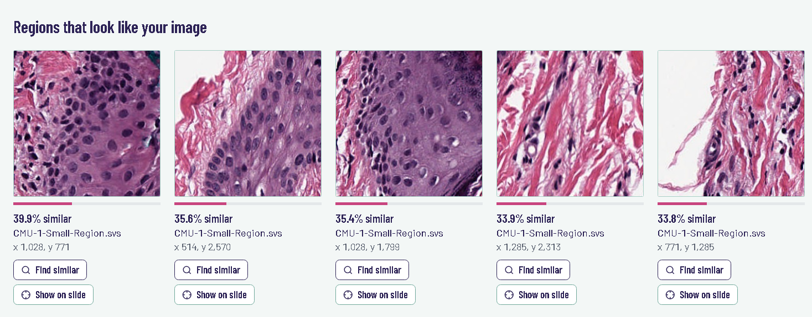
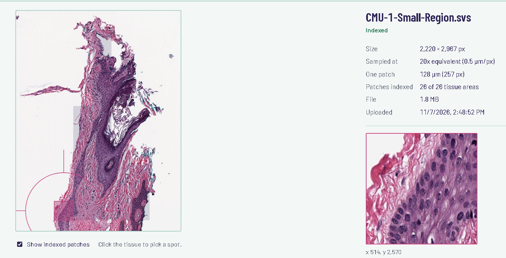
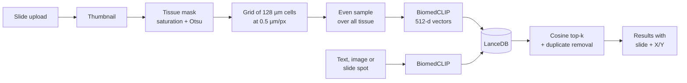

# PathoSearch 🔬

**Search whole-slide pathology images by image or by description, and see exactly where each match sits on the slide.**


# live demo - https://stupendous-fairy-8e4426.netlify.app/

PathoSearch is a **content-based image retrieval (CBIR)** system for digital pathology.
Whole-slide images (WSIs) are often 50,000 × 50,000 pixels or more. PathoSearch finds the
tissue on each slide, cuts it into patches of the same physical size (128 µm at 20×), turns
every patch into a vector with Microsoft's **BiomedCLIP**, and stores them in **LanceDB**.

You can then:
* **Describe** what you're looking for, e.g. *"lymphocytes around a blood vessel"*.
* **Drop in an image** of a tissue structure and find patches that look like it.
* **Click any spot on a slide** and find similar tissue on all your other slides.

Every result shows the slide, the exact X/Y position and a preview, and opens the slide with
the spot marked.

---

## Screenshots

**Search by description**



| Slide library | Slide viewer |
|---|---|
|  |  |

> Add your own screenshots to a `screenshots/` folder with these names.

---

## Features

* **Whole-slide coverage.** Tissue is detected on a thumbnail of the whole slide, and patches are
  spread evenly over all of it, not just the top rows.
* **Real tissue only.** Detection uses colour saturation, so white glass, black unscanned areas,
  dust and dark marker ink are skipped.
* **Same magnification for every slide.** Patches are sampled at 0.5 µm/pixel (20×) using each
  file's own microns-per-pixel, so 20× and 40× scans are compared fairly.
* **Text search.** BiomedCLIP was trained on biomedical figures and captions, so plain-language
  descriptions work.
* **Honest scores.** Cosine similarity, plus near-duplicate removal so results aren't ten
  neighbouring tiles of the same spot.
* **Background indexing.** Uploads return immediately; a job queue indexes slides with live
  progress and resumes after a restart.
* **Slide library and viewer.** Thumbnails, coverage overlay, patch previews, re-index and delete.
* **Duplicate detection.** Uploading the same file twice doesn't index it twice.
* **Works with ordinary images too.** PNG/JPEG crops can be indexed and searched.

---

## How it works



1. **Upload:** the file is streamed to disk, checked, hashed (for duplicates) and queued.
2. **Tissue detection:** a ≤2048 px thumbnail is converted to HSV; pixels above an automatic
   saturation threshold (Otsu, clamped) that aren't near-black count as tissue.
3. **Planning:** a grid of patch-sized cells is laid over the slide; cells that are at least 50%
   tissue are kept. If there are more than the chosen limit, they are sampled evenly.
4. **Reading:** each patch is read from the best pyramid level, composited onto white, resized to
   256×256 and double-checked for tissue.
5. **Embedding:** BiomedCLIP (`microsoft/BiomedCLIP-PubMedBERT_256-vit_base_patch16_224`) turns
   batches of 32 patches into normalised 512-d vectors.
6. **Search:** queries are embedded the same way (text queries with a few phrasings averaged),
   LanceDB returns nearest patches by cosine distance, and neighbours of the same spot are merged.

---

## Tech stack

| Layer | Technology |
|---|---|
| Slides | OpenSlide (`openslide-python` + `openslide-bin`), Pillow |
| AI model | BiomedCLIP via `open_clip_torch`, PyTorch (CUDA, Apple MPS or CPU) |
| Vectors | LanceDB (cosine search) |
| Records | SQLite (slides, jobs, patch positions) |
| API | FastAPI + Uvicorn |
| Frontend | React 19 + Vite 7, plain CSS, lucide-react icons |

---

## Project structure

```text
PathoSearch/
├── backend/
│   ├── main.py            # FastAPI app and routes
│   ├── config.py          # All settings (magnification, patch limits, search)
│   ├── slide_io.py        # Open slides/images, read patches, thumbnails, microns per pixel
│   ├── tissue.py          # Tissue mask, grid planning, even sampling
│   ├── extractor.py       # Slide -> planned patches
│   ├── model.py           # BiomedCLIP loader (background), image + text encoders
│   ├── vector_store.py    # LanceDB add / delete / cosine search
│   ├── database.py        # SQLite: slides, job status, patch positions
│   ├── worker.py          # Background indexing queue with progress
│   ├── ranking.py         # Duplicate removal for results
│   ├── storage.py         # Saves databases to durable storage (used on Modal)
│   ├── requirements.txt
│   ├── tests/             # test_logic.py, test_worker.py, test_storage.py (no GPU needed)
│   └── data/              # created at runtime: slides, thumbnails, lancedb, sqlite
├── frontend/
│   ├── src/
│   │   ├── pages/         # SearchPage, SlidesPage, SlideViewer, UploadPage
│   │   ├── components/    # ResultGrid, SlideCard
│   │   ├── api.js         # Backend calls
│   │   ├── router.js      # Hash routes (#/search, #/slides, ...)
│   │   └── styles.css
│   ├── package.json
│   └── vite.config.js     # Forwards /api to the backend in development
├── deploy/
│   └── modal_app.py       # Runs the backend on Modal (GPU + Volume)
├── FIXES.md               # What was wrong in v1 and how it was fixed
└── README.md
```

---

## Run it locally

You need **Python 3.10+** (3.11 recommended) and **Node.js 20.19+**. A GPU is optional; on CPU
indexing is slower but works.

### 1. Backend

**Windows (PowerShell)**
```powershell
cd backend
python -m venv venv
venv\Scripts\Activate.ps1
python -m pip install -r requirements.txt
python -m uvicorn main:app --port 8000
```

**macOS / Linux**
```bash
cd backend
python3 -m venv venv
source venv/bin/activate
pip install -r requirements.txt
python -m uvicorn main:app --port 8000
```

The first start downloads BiomedCLIP (about 800 MB). The API is at `http://127.0.0.1:8000`,
with interactive docs at `http://127.0.0.1:8000/docs`.

**NVIDIA GPU:** the default `pip install torch` on Windows is CPU-only. To use CUDA, install
PyTorch with the command for your system from [pytorch.org](https://pytorch.org/get-started/locally/).

### 2. Frontend (second terminal)

```bash
cd frontend
npm install
npm run dev
```

Open **http://localhost:5173**. The status at the top right says *Ready on CUDA/MPS/CPU* when the
model has loaded.

**One server instead of two:** run `npm run build` in `frontend`, restart the backend, and open
`http://127.0.0.1:8000`. The backend serves the built UI itself.

### 3. Try it

1. Download OpenSlide's free sample slide
   [CMU-1-Small-Region.svs](https://openslide.cs.cmu.edu/download/openslide-testdata/Aperio/CMU-1-Small-Region.svs)
   (about 1.9 MB, 20×). For a full-size slide, try `CMU-1.svs` from the same
   [folder](https://openslide.cs.cmu.edu/download/openslide-testdata/Aperio/).
2. Go to **Upload**, drop the file in and click **Upload and index**.
3. When it shows as indexed, go to **Search** and try *adipose tissue* or *lymphocytes*, or open
   the slide, click a spot and press **Find similar tissue**.

---

## Deploy it live (Modal + Netlify)

The backend runs on [Modal](https://modal.com) with a T4 GPU and a Volume for the slides and
databases; the frontend is a static site on [Netlify](https://netlify.com). Anyone can search.
Uploading, re-indexing and deleting need an **admin key** that only you know.

You need a Modal account **with a payment method** (Modal requires one for GPUs), and the Modal
CLI logged in (`python -m pip install modal`, then `python -m modal setup`).

### 1. Cap your spending
On modal.com, open **Usage & Billing** and set a **Workspace budget** (for example the free
monthly credit) so a public site can never cost more than you expect.

### 2. Create the admin key (once)
```powershell
python -c "import secrets; print(secrets.token_urlsafe(24))"
python -m modal secret create pathosearch-secrets PATHOSEARCH_ADMIN_TOKEN=<the key printed above>
```
Keep the key somewhere safe. To change it later, run the same command with `--force`.

### 3. Deploy the backend
From the `PathoSearch` folder:
```powershell
python -m modal deploy deploy/modal_app.py
```
The first deploy takes 10–15 minutes (it builds the image and downloads BiomedCLIP into it).
At the end, copy the URL after `web =>`. It looks like
`https://<your-modal-username>--pathosearch-web.modal.run`.

Check it: open `https://<your-url>/api/health`. The first request after a quiet period takes
30–60 seconds while the container starts; then you'll see `"model_ready": true`.

### 4. Build the frontend with that URL
```powershell
Set-Content -Path frontend\.env -Value "VITE_API_URL=https://<your-url>.modal.run" -Encoding ascii
cd frontend
npm install
npm run build
```
This creates `frontend/dist` with your backend URL built in.

### 5. Put it on Netlify
1. Log in at [netlify.com](https://netlify.com).
2. Open [app.netlify.com/drop](https://app.netlify.com/drop) and drag the **`frontend/dist`** folder onto it.
3. You get a `*.netlify.app` link. Rename it under **Site configuration → Change site name**.

PathoSearch uses `#/` links, so no redirect rules are needed.

### 6. Add slides
Open your site, go to **Upload**, paste your admin key, and upload slides. Visitors without the
key can search and view slides but not change anything.

### Updating
* Backend: `python -m modal deploy deploy/modal_app.py` (slides, vectors and records are kept).
* Frontend: `npm run build`, then drag the new `dist` folder onto your site's **Deploys** page.

### How it runs on Modal (and what it costs)
* One container runs the API, the indexing worker and the model. It shuts down after
  **10 idle minutes**, so you only pay while people use it. Change `IDLE_SHUTDOWN_S` or set
  `GPU = None` (CPU only: cheaper, slower indexing) in `deploy/modal_app.py`.
* Slide files live on the Volume `pathosearch-data`. SQLite and LanceDB run on the container's
  local disk and are copied to the Volume after every upload, finished job and delete, then
  restored at the next start.
* The website stops polling the server when nothing is happening, so an open tab doesn't keep
  the GPU running.
* Uploads are limited to 2 GB on Modal (`PATHOSEARCH_MAX_UPLOAD_GB`). If a container stops in the
  middle of indexing, the job restarts automatically the next time the site is opened.

---

## API

| Method | Route | What it does |
|---|---|---|
| GET | `/api/health` | Model status, device, OpenSlide available, counts |
| POST | `/api/slides` | Upload a slide (`file`, optional `max_patches`); indexing runs in the background |
| GET | `/api/slides` | List slides with status and progress |
| GET | `/api/slides/{id}` | One slide |
| DELETE | `/api/slides/{id}` | Delete the slide, its file and its vectors |
| POST | `/api/slides/{id}/reindex` | Index again (optional `max_patches`) |
| GET | `/api/slides/{id}/thumbnail` | Overview image |
| GET | `/api/slides/{id}/patches` | Positions of all indexed patches |
| GET | `/api/slides/{id}/patch?x=&y=` | A 256×256 patch at level-0 position x, y |
| GET | `/api/search/text?q=` | Search by description |
| POST | `/api/search/image` | Search with an image (`file`) |
| GET | `/api/search/similar?slide_id=&x=&y=` | Find patches like the one at x, y |
| POST | `/upload_slide/`, `/search_patch/` | The original v1 endpoints, still supported |

All coordinates are **level-0 pixels** of the original slide. When `PATHOSEARCH_ADMIN_TOKEN` is
set, uploading, re-indexing and deleting need the header `X-Admin-Token: <key>`.

---

## Configuration

Settings live in `backend/config.py`.

| Setting | Default | Meaning |
|---|---|---|
| `TARGET_MPP` | `0.5` | Microns per pixel every slide is sampled at (0.5 = 20×) |
| `PATCH_SIZE` | `256` | Patch size in pixels (256 px × 0.5 µm = 128 µm) |
| `DEFAULT_MAX_PATCHES` | `2000` | Patches per slide if more tissue is found (spread evenly) |
| `MIN_TISSUE_FRACTION` | `0.5` | How much of a cell must be tissue |
| `MIN_SATURATION` | `20` | Lowest saturation counted as stain |
| `DARK_VALUE` | `40` | Pixels darker than this are treated as artefacts |
| `NEIGHBOUR_DISTANCE` | `2.0` | Results closer than this many patches on one slide are merged |
| `PATHOSEARCH_DATA` (env) | `backend/data` | Where slides and thumbnails are stored |
| `PATHOSEARCH_DB_DIR` (env) | same as data | Where SQLite and LanceDB are stored |
| `PATHOSEARCH_ADMIN_TOKEN` (env) | empty | If set, uploads/re-index/delete need this key |
| `PATHOSEARCH_MAX_UPLOAD_GB` (env) | `10` | Largest accepted upload |
| `PATHOSEARCH_CORS` (env) | localhost:5173 | Websites allowed to call the API (`*` = any) |

---

## Tests

From `backend` (only numpy and Pillow are needed):

```bash
python tests/test_logic.py    # tissue detection, coverage, magnification, ranking
python tests/test_worker.py   # full indexing job with a stand-in model
python tests/test_storage.py  # saving/restoring databases (used on Modal)
```

---

## Troubleshooting

| Problem | Fix |
|---|---|
| Upload says OpenSlide isn't installed | `pip install openslide-python openslide-bin` (this includes the OpenSlide library, also on Windows) |
| Status says *Backend offline* | Start the backend: `python -m uvicorn main:app --port 8000` in `backend` |
| Status says *Model failed to load* | Hover it for the reason. Usually a package mismatch: `pip install -U open_clip_torch "transformers>=4.40,<5"` |
| Indexing is slow | It's running on CPU. Use **Quick** (500 patches), or install CUDA PyTorch |
| A slide failed with *No tissue found* | The stain is very faint; lower `MIN_SATURATION` in `config.py` and press **Re-index** |
| `.mrxs` / `.vms` files are rejected | These formats need several files; convert to a single-file format first |
| Port 8000 is in use | Use another port and update `vite.config.js` to match |
| Live site: "Admin key required" | Enter the key from step 2 of the deploy guide on the Upload page |
| Live site: "Backend offline" for a minute | The Modal container is starting; wait 30–60 s |
| Modal deploy: secret `pathosearch-secrets` not found | Do step 2 of the deploy guide first |
| Modal deploy: "add a payment method to use T4" | Add a card on Modal, or set `GPU = None` in `deploy/modal_app.py` |

---

## Privacy

Real patient slides can contain identifiable information. PathoSearch never reads the slide's label
or macro image, only the tissue image. Even so, don't put identifiable patient data on a public
server. For demos, use public datasets such as OpenSlide test data, TCGA or CAMELYON.

---

## Roadmap

- [ ] Login and per-user libraries
- [ ] Stain normalisation (Macenko/Reinhard) for slides from different labs
- [ ] Approximate nearest-neighbour index for millions of patches
- [ ] Zoomable deep-zoom viewer instead of a static overview

See [FIXES.md](FIXES.md) for everything that was changed from version 1.
